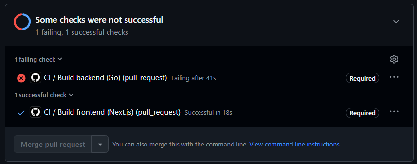

# Decisiones — TP1

## 1. Por qué Git no pudo resolver el conflicto solo — y qué habría tenido que pasar para que nunca apareciera.
Git no puede resolver el conflicto por su propia cuenta ya que no sabe cual es la intencion de la persona que pusheo.
Para que el problema nunca hubiera aparecido lo que se puede hacer es traer los cambios del main antes de hacer la pull request. Resolves conflictos antes de pushear.

## 2. Qué problemas encontraste y cómo los solucionaste.
El unico problema que tuve y se pueden ver en los commits es que me olvide de activar el ruleset entonces el primer commit si paso directo a produccion.
despues active el ruleset y ya funciono.

## 3. Declaración de uso de IA: qué partes hiciste con ayuda de inteligencia artificial y cómo verificaste lo que te devolvió.
Hasta ahora no utlice la IA para mucho mas que buscar comandos.

# Decisiones — TP2

## 1. Porque elegi esta app?
Docuwave es una app que estoy construyendo activamente y que conozco muy bien. Ademas cumple con los requerimientos de estructura del proyecto (Front + back + db).
Aparte de todo esto es una app en la cual ya tengo CI y test implementados. Trabajo con Github Flow.

## Decisiones de contenerización:
Las imagenes base elegidas son:
- Backend (go), en etapa de build golang:1.24-alpine ya que esta incluye todas las herramientas necesarias para que el proyecto compile. Es muy importante utilizar esta version ya que la 1.23 no compila por falta de funcionalidades.
Luego en la etapa de build se utiliza la alpine:3.20. Go compila a binario estatico por la imagen de ejecucion no necesita runtime alguno. Solo se necesita el binario y el cerificado TLS para las llamadas como las de OAuth.
- Frontend (Next.js), todas las etpas del multistage utilizan el node:20-alpine esto es para evitar incompatibilidades de binarios nativos entre etapas.

Etapas: 
- Backend: Utiliza 2 etapas:
builder en donde se copia go.mod y go.sum y despues se corre go mod download esto es para cachear las dependencias y no descargalas en cada build. Luego copia el codigo y lo compila.
Despues esta la etapa final la cual copia unicamente el binario compilado.
- Frontend: utiliza 3 capas:
La primera capa "deps" instala las dependencias con npm ci utilizando el package.json, esto lo hace esta capa para una vez para cachear las dependencias y no tener que instalarlas en cada build.
La etapa de "builder" utiliza las deps cacheadas y copia el codigo fuente y corre npm run build. 
Luego la etapa de "runner" copia lo minimo para poder ejecutar (.next/standalone, .next/static y la carpeta public). Esta etapa no copia el codigo fuente ni "node_modules".

Que persiste y que no?:
Lo unico que persiste es el volumen de la base de datos de postgres. Este solo se borra si se hace de manera manual o si se agrega la flag -v en el docker compose down

- Se utiliza el dns interno de docker compose.

## 2. Qué problemas encontraste y cómo los solucionaste.
No me encontre con muchos problemas ya que yo ya contaba con los Dockerfiles del proyecto, si tuve problemas con las creedenciales de github ya que no me dejaba iniciar sesion para subir las imagenes compiladas.

## 3. Declaración de uso de IA: qué partes hiciste con ayuda de inteligencia artificial y cómo verificaste lo que te devolvió.
Para este tp utilize a la IA como guia paso a paso para crear la imagenes y subirlas como package de github. Pude verifcar que lo que me daba estaba bien a traves de las consignas del tp ya que fui comparando paso a paso que todo estaba correcto.

# Decisiones — TP3

## 1. Decision tiempo de la sprint:
Se decidio que la sprint va a durar 1 semana ya que esto es el tiempo en el cual se desarollan las actividades de la materia, un tp por semana. Por lo que el tiempo limite para desarollar el tp4 (teoricamente) es hasta el jueves 3 de septiembre.

## Decision de la cantidad de tareas que se pueden hacer al mismo tiempo:
Se decidio solo tener 2 tareas como maximo al mismo tiempo para que no se acumule trabajo sin terminar que el que peudo gestionar. Este numero viene de utlizar la regla de participantes + 1, este 1 nos permite tener flexibilidad opertiva ya que si ocurre un bloqueo o queremos preparan una tarea antes de terminal la que esta en progreso esto nos permite hacerlo.

## Decision de las tareas para la HU-1:
Yo ya tengo una implementacion de un workflow de CI en el repo orginal del proyecto [docuwave](https://github.com/max20050/DocuWave) por lo que la primer tarea para mi sera migrar ese archivo .yml al repo actual.
Despues puse como segunda tarea agregar el badge del CI al readme.md

## 2. Qué problemas encontraste y cómo los solucionaste.
En este tp no hubo problemas ya que segui la guia paso a paso e implemnte todo lo que pedia. 

## 3. Declaración de uso de IA: qué partes hiciste con ayuda de inteligencia artificial y cómo verificaste lo que te devolvió.
Para este tp no utilice la IA.

# Decisiones — TP4

## 1. Estructura elegida del pipeline
 
El workflow (`.github/workflows/ci.yml`) corre en cada Pull Request contra main y en
cada push a main. Se definieron dos jobs independientes:
 
- `build-backend`: construye la imagen del backend (Go) usando el Dockerfile de `backend/`.
- `build-frontend`: construye la imagen del frontend (Next.js) usando el Dockerfile de `frontend/`.
Son dos jobs porque la app tiene dos Dockerfiles reales (uno por componente). Cada imagen se construye con un proceso de build totalmente distinto (Go compila a un binario estático, Next.js
necesita instalar dependencias de Node y correr un build de la aplicación), así que
tiene sentido que sean pasos separados en vez de mezclarlos en un mismo job.
 
Corren en paralelo porque no hay ningúna dependencia entre ellos para compilar. Esto además acorta el tiempo total del pipeline: en vez de sumar el tiempo de build de
las dos imágenes, GitHub Actions las corre en runners simultáneos y el tiempo total es
el del job más lento, no la suma de ambos.
 
## 2. Qué cachea el pipeline
 
Se usa el backend de cache de Buildx `type=gha` (cache nativa de GitHub Actions), con
un `scope` separado por job (`scope=backend` y `scope=frontend`) para que no se pisen
entre sí.
 
**Qué se reutiliza:**
- Las capas de dependencias que no cambiaron entre corridas. Por ejemplo, en el
  backend, la capa de `go mod download` (o `go mod tidy`) se reutiliza si el
  `go.mod`/`go.sum` no cambió. En el frontend, la capa de `npm install` /
  `npm ci` se reutiliza si `package.json` / `package-lock.json` no cambiaron.
- Cualquier capa intermedia del Dockerfile cuyo contexto de entrada (los archivos que
  copia esa instrucción `COPY`) no haya sido modificado respecto a la corrida anterior.
  Esas capas aparecen como `CACHED` en el log del build.
**Qué NO se reutiliza:**
- Las capas posteriores a la primera línea del Dockerfile que cambió. Docker cachea
  capa por capa en orden: si cambia el código fuente (por ejemplo un `.go` o un `.tsx`),
  todo lo que dependa de ese `COPY` en adelante se reconstruye (compilación del
  binario, build de Next.js), aunque las dependencias de más arriba sigan cacheadas.
- Si cambian `go.mod`/`go.sum` o `package.json`/`package-lock.json`, se invalida
  también la capa de instalación de dependencias, y todo lo posterior a esa capa.
**Qué pasa si el cache desaparece** (por ejemplo, expira, se borra manualmente, o es la
primera corrida del workflow en el repo): el build simplemente corre completo, sin
ningún `CACHED` en el log, exactamente igual que en un ambiente limpio. No rompe el
pipeline ni el resultado del build; el único costo es que la corrida tarda más porque
tiene que descargar dependencias y reconstruir todas las capas desde cero. La próxima
corrida vuelve a poblar la cache normalmente.
 
## 3. Por qué el pipeline construye con el Dockerfile en vez de compilar por su cuenta:

La razón es que el pipeline tiene que verificar exactamente lo que se va a desplegar,
no una aproximación. Si el CI compilara "a mano" con el toolchain del runner
(su propia versión de Go o de Node, sus propias variables de entorno), podría pasar
que el pipeline esté verde pero la imagen Docker real falle al construirse

## 4. Problemas encontrados y cómo los resolví:
No fue un problema pero tuve que cambiar bastante la estructura de ci.yml ya que en docuwave yo no publico aun el package del build, si hago que pase los tests y pruebo que las imagenes compilen bien antes de mergear. Ademas borre algunas funcionalidades que no entran en este tp como publicar los resultados de los tests.

## 5. Declaración de uso de IA

Usé Claude para generar un borrador inicial del ci.yml. Luego ajusté manualmente los nombres de los jobs, los paths de los Dockerfiles
y verifiqué el comportamiento del cache corriendo el pipeline dos veces en mi propio
repo antes de dar esto por válido.

## 6. Algunas cosas del tp3 las resolvi aca:
La parte de generar un bug y resolverlo y que quede reflejada en el tablero la resolvi en este tp. Esto es para que se pueda aprovehcar ese bug y probar que el build falle y no nos deje mergear. Luego agrege el bug como issue, publique la solucion y lo cerre.


# Decisiones — TP5

## 1. Qué lógica elegí testear y por qué

Backend — de todo lo que ya tenía testeado (el proyecto ya tenía bastante suite de antes
de este TP), elegí citar estas 4 reglas porque son las que más duelen si se rompen:

- **Hashing de contraseñas** (`internal/auth`): si esto se rompe, se filtran contraseñas o
  se deja entrar a cualquiera. Es lo más crítico de seguridad que tengo.
- **Emisión/verificación de JWT** (`internal/auth`): es el guardián de cada endpoint
  autenticado. Un bug acá es un login falso o una sesión que no expira.
- **Compilación de queries** (`internal/query`): acá se arma el SQL real contra la base del
  usuario a partir de lo que mandó el frontend. Si esto falla mal, es una inyección SQL o
  un reporte con datos de otro usuario.
- **El runner le pasa el query compilado al connector tal cual** (`internal/report`): es el
  único camino por el que pasa CADA reporte (preview, descarga, programado). Si acá se
  llama dos veces o con el query equivocado, el usuario recibe datos mal.

Para el **mock obligatorio** elegí `datasource.Connector` (la interfaz que usa
`runnable.run`): es el único boundary externo de verdad que tengo bien aislado detrás de
una interfaz (habla con Postgres/MySQL/Sheets/REST según el tipo de fuente). Armé un
`spyConnector` a mano que graba cuántas veces y con qué argumentos se llamó `RunQuery`, y
el test (`TestRunnableRunCallsConnectorWithTheCompiledQuery`) verifica la interacción, no
solo el resultado — por eso es un mock y no un fake como los que ya tenía
(`fakeCustomSource`, `stubTemplate`, que solo devuelven datos fijos).

Frontend — mi app no tiene un archivo de lógica pura como el `tareas.js` del ejemplo:
`lib/api.ts` es casi todo wrappers CRUD contra el backend, y la UI vive en componentes
`"use client"`. Dentro de `report-builder.tsx` había funciones sueltas, ya puras, que
nadie testeaba porque vivían pegadas al componente: `errorMessage`, `sameColumns`,
`operatorArity`, `columnBadge`. Las saqué a `lib/report-builder-helpers.ts` (mismo
comportamiento, sin tocar nada de lo que hacen) para poder testearlas sin DOM. Para el
mock, mockeé `global.fetch` en `lib/api.ts` y verifiqué que `login`/`authFetch` lo llaman
con la URL, método, headers y body correctos — es la misma idea del `pendientesDe` de la
guía, pero sin tener que inyectar un parámetro nuevo porque `fetch` ya es una dependencia
global reemplazable.

## 2. Umbral de coverage

**Backend: 44% sobre statements, total agregado** (no por paquete). Medido hoy:
**46.0%**. Elegí statements porque Go no mide branch coverage de forma nativa — ni
`go test -cover` ni `go tool cover` tienen un modo de rama; es una limitación real del
toolchain, no una elección mía (la guía lo permite explícitamente para stacks donde no
existe). Puse el umbral un poco por debajo de mi medición real (46.0%) para que no
arranque roto ni sea tan ajustado que una corrida con una sola función nueva sin tests ya
lo tire — hice la cuenta: con 3509 statements contados hoy y 1613 cubiertos, hacen falta
más de ~157 statements nuevos sin cubrir para bajar del 44%. Eso es una feature de tamaño
normal, no una trampa de 3 líneas — es justo lo que necesito para la demostración de la
Tarea 3 sin que sea ni imposible ni trivial de romper.

**Frontend: 90% de líneas y 90% de ramas**, sobre `lib/report-builder-helpers.ts`
únicamente. Hoy da **100% / 100%** en los dos. Acá vitest sí mide rama (a diferencia del
backend), así que el número de rama existe y lo uso como parte del umbral.

## 3. Qué dejé afuera de la cuenta de cobertura, y por qué

**Backend:**
- `cmd/api` — es el arranque: wiring de rutas, middlewares y configuración. No tiene
  reglas de negocio, y si está mal el servidor directamente no levanta.
- `internal/migrate` — aplica archivos `.sql` embebidos contra Postgres. No tiene ninguna
  regla que verificar (es "ejecutá estos archivos en orden"), y testearlo de verdad
  requeriría una base de datos real, lo que lo vuelve un test de integración, no unitario.

Los excluí filtrando los paquetes antes de correr `go test` (`go list ./... | grep -v
'/cmd/api$|/internal/migrate$'`), ya que Go no tiene un atributo tipo
`[ExcludeFromCodeCoverage]` — la exclusión es a nivel paquete, no a nivel clase. Ninguno de
los dos paquetes tenía ninguna regla movida a otro lado para "esconderla": están vacíos de
lógica de negocio desde que se escribieron.

**Frontend:**
- `lib/api.ts` — son ~890 líneas, la gran mayoría wrappers CRUD casi idénticos
  (`listDataSources`, `createReport`, `deleteRecipient`...) que solo llaman a `authFetch` y
  parsean la respuesta, sin ninguna rama propia. Sí tiene tests (`lib/api.test.ts`, el
  mock de `login`/`authFetch`), pero no cuentan para el umbral porque medirían sobre todo
  el boilerplate sin probar, no sobre lógica.
- `auth-context.tsx` — wiring de React Context, sin ninguna regla de negocio.

## 4. Por qué coverage alto no garantiza calidad (con mi ejemplo)

El caso real lo tengo en mi propio reporte: `wholeNumber` (en `internal/query/resolve.go`)
tenía 30% de cobertura de statements mientras el paquete entero estaba en 88%+ — ese 88%
alto escondía una función con casi ninguna rama probada. Si en vez de eso alguien hubiera
escrito un test que solo llama a `wholeNumber(float64(7))` sin ningún `assert` sobre el
resultado, esa línea igual queda "cubierta" (se ejecutó), y el número de cobertura del
paquete no se mueve ni un poco — pero no demuestra que la función rechace un valor
fraccionario como `7.5`, que es exactamente el bug que encontré en el punto 5. Cobertura
mide que una línea corrió, no que alguien comprobó qué devolvió.

## 5. El ejercicio de la rama sin cubrir (§3.0)

- **Línea**: `internal/query/resolve.go:383`, dentro de `wholeNumber` —
  `if typed != float64(int(typed))`, la rama que rechaza un `float64` que no es un número
  entero.
- **Entrada que la recorre**: un filtro `last_days` con un valor fraccionario, por ejemplo
  `7.5` días.
- **Qué decidí**: lo agregué. `TestCompileRejectsFractionalLastDays` en
  `internal/query/compile_test.go` — subió `wholeNumber` de 30.0% a 40.0% de statements.
  Lo elegí porque es exactamente el tipo de bug silencioso que preocupa: antes de este
  test, nada impedía que `7.5` se redondeara o truncara silenciosamente a un reporte con
  una ventana de fechas distinta a la que el usuario pidió.

## 6. Mi stack no es el de la cátedra (.NET + vitest) — backend es Go

| Fila de la tabla | Lo que usé |
|---|---|
| Dónde viven los tests | al lado del código que prueban, `algo_test.go` (es la convención de Go, no una carpeta aparte) |
| Un test parametrizado | tabla de casos (`[]struct{...}`) + `t.Run` por caso — equivalente a `[Theory]`+`[InlineData]` |
| Que la dependencia entre desde afuera | interfaz de Go (`datasource.Connector`) recibida por `runnable`, ya existía |
| Fabricar el doble (mock) | no usé ninguna librería (no hay Moq en Go estándar): escribí `spyConnector` a mano implementando la interfaz y grabando las llamadas |
| Medir la cobertura | `go test -coverprofile=coverage.out` + `go tool cover -func=coverage.out` |
| Umbral que rompe el build | no existe un flag nativo (a diferencia de `coverlet.msbuild`): escribí `backend/scripts/check-coverage.sh`, que lee el total de `go tool cover` y compara a mano — tal cual lo anticipa la guía para stacks sin esa bandera |
| Qué entra en la cuenta | filtrado de paquetes con `go list ./... \| grep -v ...` antes de correr los tests — no hay atributo por clase, la exclusión es por paquete |

El frontend sí es el de la cátedra (Next.js usa vitest igual que el ejemplo), así que esa
mitad de la guía se siguió tal cual.

## 7. Si refactoricé para poder mockear

- **Backend**: no hizo falta ningún refactor. `runnable.connector` ya era
  `datasource.Connector`, una interfaz inyectada desde `Runner.prepare`. Solo escribí el
  spy y el test.
- **Frontend**: extraje `errorMessage`, `sameColumns`, `operatorArity` y `columnBadge` de
  `app/ui/report-builder.tsx` a `lib/report-builder-helpers.ts`. No cambié qué hacen —
  verifiqué con `npm run type-check` y `npm run lint` que el comportamiento quedó
  idéntico — solo las saqué del componente para poder importarlas sin renderizar nada.

## 8. Problemas encontrados y cómo los resolví

- El `.gitignore` de la raíz tenía una regla `scripts` (sin la barra inicial), que en
  sintaxis de `.gitignore` ignora **cualquier** carpeta llamada `scripts` en cualquier
  parte del repo — incluida `backend/scripts/`, donde iba el script del umbral. Si no lo
  encontraba, el script se hubiera commiteado "bien" en mi máquina y desaparecido en
  cualquier otro lado (exactamente la clase de bug silencioso que advierte la guía). Lo
  acoté a `/scripts` (solo la raíz), que es lo único que necesitaba estar ignorado.
- Al instalar vitest, `npm i -D vitest` sin versión trajo vitest 5, que pide
  `@types/node` 22+/24+ como peer — mi proyecto tiene `@types/node` fijado en `^20` (por
  Next 16) y el install fallaba con `ERESOLVE`. Instalé `vitest@3` explícitamente (mismo
  problema que la guía anticipa para el ejemplo de cátedra) y después
  `@vitest/coverage-v8@3` para que coincida la versión mayor.

## 9. Declaración de uso de IA

Utilice claude para hacer los tests

## 10. La demostración de la Tarea 3

**Primer PR — cuenta la historia completa (rojo → fix → verde → merge):**
[#18](https://github.com/Max20050/Ingsoft3/pull/18). Agregué `filterSummary` en
`lib/report-builder-helpers.ts` — una función con 5 caminos (none/pair/many/count/one) que
describe en una frase cada fila de filtro, para un lector de pantalla — y la subí sin un
solo test. Compiló perfecto y ningún test existente se rompió.

- Corrida roja, por cobertura: [`…/actions/runs/37655996935`](https://github.com/Max20050/Ingsoft3/actions/runs/37655996935) —
  `ERROR: Coverage for lines (52.94%) does not meet global threshold (90%)`. Rompió por
  **líneas**, no por ramas: la función todavía no la llamaba ningún test, y en vitest 3 una
  función que nadie invoca no suma a la cuenta de ramas (sólo a la de líneas sin cubrir) —
  es la misma distinción del §3.5 de la guía.
- Agregué un test por camino (5) más los casos que ejercitan cada `??` de respaldo (6 más,
  11 tests en total) — al llamar la función, sus ramas internas empezaron a contar, y la
  primera tanda de tests (sin los casos de respaldo) la dejó en 81.25% de rama, todavía por
  debajo del 90%. Hubo que cubrir también los `??`, no solo los 5 switch-case.
- Corrida verde después del fix, mismo PR: el check `Build frontend (Next.js)` pasó a
  `pass` y `mergeStateStatus` de la PR pasó de `BLOCKED` a `CLEAN`.

# Decisiones — TP6

## Enlaces de este TP

- **Paquetes públicos** (probado con un `docker pull`/`tags list` totalmente anónimo, sin
  `docker login` ni token — una llamada directa al registry con un token anónimo de
  `ghcr.io/token`, sin usar mi cuenta):
  - Backend: https://github.com/Max20050/Ingsoft3/pkgs/container/ingsoft3-backend —
    tag `sha-91fb71db674b0c479fde887e95fd27e8cbe60638`
  - Frontend: https://github.com/Max20050/Ingsoft3/pkgs/container/ingsoft3-frontend —
    mismo tag
- **La cadena de confianza del registry** (Tarea 1):
  1. PR con los tests en verde, donde «Entrar al registry» aparece **salteado** (el evento
     no es `push`, así que el `if` lo saltea, no un error):
     https://github.com/Max20050/Ingsoft3/actions/runs/38503034378/job/115654149935
  2. Corrida de `main` donde «Construir y publicar la imagen del backend» es el **último**
     paso del job (antes sólo hay `Post …` que agrega GitHub):
     https://github.com/Max20050/Ingsoft3/actions/runs/38503181350/job/115654603548
- **URLs vivas**:
  - QA: front https://ingsoft3-front-qa-dtom.onrender.com · api https://ingsoft3-api-qa-6umv.onrender.com
  - PROD: front https://ingsoft3-front-prod-5clx.onrender.com · api https://ingsoft3-api-prod-hb4s.onrender.com
- **Release**: https://github.com/Max20050/Ingsoft3/releases/tag/v6.0.0

> Mi stack no es el de la guía (.NET + Vite + nginx aparte): backend es **Go** y frontend es
> **Next.js**. Donde la guía asume algo específico de ese stack lo aclaro en el punto
> correspondiente — en general salió más simple de lo que la guía anticipa (Go lee
> `DATABASE_URL` como URI cruda, sin traducir a pares `Clave=Valor`; las migraciones corren
> solas con mi propio `migrate.Run()`, equivalente al `EnsureCreated()`).

## 1. Por qué el artefacto se publica sólo con la verificación en verde

Porque si el registry tuviera imágenes publicadas sin pasar los tests, la palabra
«publicado» dejaría de significar «pasó la verificación» y pasaría a significar
únicamente «alguien construyó esto alguna vez» — que es la trampa que describe la guía. En
mi `ci.yml` esto no es un `if` que lea el resultado de los tests: es **orden de pasos**. El
paso que construye y publica la imagen (`Construir y publicar la imagen del backend/frontend`)
es el **último** del job, después de «Build the backend/frontend tests stage», «Run … tests
with coverage» y el reporte de coverage. Si el `docker run` de los tests devuelve rojo, el
job muere ahí mismo y ese último paso directamente **no llega a ejecutarse** — no hace falta
ningún `if: success()` porque es el comportamiento por defecto de GitHub Actions (cortar al
primer error). Lo verifiqué mirando el log de una corrida real (la del punto «Enlaces»):
en la corrida de main los 10 pasos corrieron en ese orden exacto.

La cadena completa son tres eslabones, no uno: (1) nada entra a `main` sin el pipeline en
verde (gate del TP4/TP5), (2) `push: ${{ github.event_name == 'push' && github.ref ==
'refs/heads/main' }}` hace que sólo un push a `main` pueda llegar a publicar, y (3) el paso
que publica es el último del mismo job que corrió los tests. Ninguno de los tres solo
alcanza: sin el (3), un pipeline podría publicar primero y testear después y cumplir (1) y
(2) igual, con el registry lleno de imágenes rotas.

## 2. Continuous Delivery vs Continuous Deployment: cuál implementé

Implementé **Continuous Delivery**: todo push verde a `main` llega automáticamente a QA, y
de ahí a PROD sólo con una aprobación humana explícita (`environment: production` con
required reviewer). No es Continuous Deployment porque el último paso hacia producción no es
automático — hay un `Waiting for review` real en el medio, que yo mismo aprobé o rechacé.

Elegí Delivery y no Deployment porque mi red de seguridad automática no es lo
suficientemente madura para sacar al humano: mi cobertura de tests (TP5) es sobre lógica
puntual (hashing, JWT, compilación de queries), no sobre todo el sistema, y mi smoke test
sólo prueba que la app responde — no prueba que una feature nueva funcione bien de punta a
punta. Si sacara la aprobación humana hoy, estaría automatizando la propagación de errores a
producción sin tener la observabilidad (TP9) que avisaría a tiempo. Para llegar a Continuous
Deployment en serio me faltaría: monitoreo real en producción con alertas, un conjunto de
smoke/e2e tests que cubra los flujos críticos (no sólo "responde"), y feature flags para
poder apagar algo sin un rollback completo.

## 3. El diseño de la cadena (`needs`/`if`/`environment`) y el alcance de los secrets

```
build-backend    (sin needs)                              ← publica sólo si push a main
build-frontend   (sin needs)                               ← ídem
deploy-qa        needs: [build-backend, build-frontend]    · environment: qa
                 if: github.ref == 'refs/heads/main'         (los PR no despliegan)
deploy-prod      needs: deploy-qa                           · environment: production
                 (sin if propio — lo hereda de deploy-qa: si deploy-qa no corrió          
                  porque es un PR, deploy-prod tampoco corre)
                 concurrency: { group: deploy-prod, cancel-in-progress: false }
```

Los secrets de deploy viven **en el environment**, no en el repo:

| Secret | Environment | Quién lo puede leer |
|---|---|---|
| `RENDER_HOOK_API_QA`, `RENDER_HOOK_FRONT_QA` | `qa` | cualquier job con `environment: qa` (sin aprobación, QA es automático a propósito) |
| `RENDER_HOOK_API_PROD`, `RENDER_HOOK_FRONT_PROD` | `production` | sólo un job con `environment: production` **después** de que el reviewer lo aprueba |
| `GITHUB_TOKEN` | repo (automático) | lo emite GitHub por corrida, con los permisos que declaro en `permissions:` de cada job (`packages: write` sólo en `build-backend`/`build-frontend`, mínimo privilegio) |

Las connection strings de Neon (`DATABASE_URL` de `app_qa`/`app_prod`) **no son secrets de
GitHub**: son variables de entorno configuradas directamente en cada servicio de Render
(`ingsoft3-api-qa` / `ingsoft3-api-prod`). Mi pipeline nunca las toca ni las necesita — sólo
dispara el deploy hook, y Render arranca el contenedor con la configuración que ya tiene
guardada. Separar esto así es justo lo que hace que la misma imagen (o en este caso, el
mismo commit reconstruido, ver punto 6) sirva en los dos entornos: lo único que cambia entre
QA y PROD vive en Render y en Neon, no en GitHub ni en el código.

Si estos secrets estuvieran en el repo en vez del environment, cualquier job de cualquier
workflow (incluido uno que corre sobre un PR de un fork, si algún día acepto contribuciones
externas) tendría acceso a disparar un deploy a producción. Con el secret en el environment
`production`, sólo un job que declare `environment: production` **y** que pase la revisión
puede leerlo — es el mismo alcance de secrets de environment vs. repo que ya usamos para
separar QA de PROD.

## 4. Qué mira mi aprobador antes de aprobar

Antes de aprobar un deploy a producción, lo que reviso es: (1) que `deploy-qa` haya
terminado en verde en esa misma corrida (si QA no pasó, no tiene sentido promover ese
commit); (2) qué cambia ese commit — si toca algo sensible (credenciales, connection string,
esquema de datos) lo miro con más cuidado que un cambio de texto; (3) si hay más de una
corrida esperando aprobación a la vez, reviso cuál es la más reciente y rechazo las viejas a
mano (ver §3.4 de la guía: aprobar una corrida vieja después de una nueva hace retroceder
PROD). En la práctica de este TP usé estos criterios literalmente: rechacé la primera
corrida porque el smoke de QA había tardado sólo 5 segundos y quería confirmar en el log que
no era un falso verde por cache antes de promoverlo, y aprobé la segunda después de
confirmar que el smoke de QA había corrido bien y que el cambio (un texto del login) era de
riesgo mínimo.

Lo que el aprobador **no** puede ver, y es una limitación real: no tengo ninguna métrica de
producción (latencia, tasa de error, uso de CPU/memoria) delante en el momento de aprobar —
sólo tengo el resultado binario del smoke test de QA. Si algo degrada performance sin
romper el `/health`, no lo veo hasta después del deploy. Eso es exactamente lo que el TP9
(observabilidad) viene a cerrar.

## 5. La letra chica de mi free tier

- **Cold start**: los 4 servicios de Render duermen a los ~15 minutos sin tráfico; el primer
  request después de dormir tarda hasta ~1 minuto. Por eso el smoke test de `deploy-qa` y
  `deploy-prod` reintenta 30 veces cada 20 segundos (hasta 10 minutos) en vez de un `curl`
  seco — en la práctica, en mis corridas reales el smoke pasó en 5-33 segundos porque los
  servicios ya estaban despiertos de pruebas anteriores, pero el reintento está para el caso
  frío.
- **Horas de instancia** (750/mes por workspace) y **minutos de build** (500/mes): cada
  push a `main` reconstruye 2 imágenes en Render (backend y frontend de QA), y cada
  aprobación a PROD reconstruye 2 más — hasta 4 builds de Render por ciclo completo. Todavía
  no me quedé sin cupo, pero lo voy a estar mirando en *Workspace → Billing* a medida que se
  acerque la defensa, porque si se agota, Render deja de construir hasta fin de mes y el
  smoke seguiría dando verde contra la versión vieja sin que nada lo avise.
- **Neon**: el cómputo se suspende a los ~5 minutos de inactividad y se despierta solo, más
  rápido que Render. Hasta ahora no pegué contra el límite de almacenamiento (0.5 GB) ni de
  horas de cómputo mensuales.

## 6. Qué garantía pierdo porque Render reconstruye desde el repo

Mi pipeline publica una imagen etiquetada con el commit (`ghcr.io/.../ingsoft3-backend:sha-<commit>`),
pero el deploy hook de Render no usa esa imagen: le pide a Render que **vuelva a construir**
el mismo commit desde el Dockerfile del repositorio. Así que lo que corre en QA y PROD es
una **segunda construcción** del mismo código, no la imagen que mis tests verificaron. En la
práctica eso significa que si una dependencia de Go o de npm resuelve a una versión distinta
entre el build de GitHub Actions y el build de Render (porque alguna no está fijada con una
versión exacta, o una imagen base como `node:20-alpine`/`golang:1.24-alpine` se actualizó
entre un build y el otro), el binario que corre en producción podría no ser bit-a-bit
idéntico al que pasó los tests — aunque venga del mismo commit. Lo que promuevo es el
**commit verificado**, no la **imagen verificada**. Convertir esa garantía en real —que
Render (o lo que sea) despliegue literalmente la imagen que publiqué en el §3.0, no una
reconstrucción— es, según la guía, exactamente el problema que resuelve el TP7.

## 7. Qué prueba mi smoke test y qué no

Mi smoke test (en `deploy-qa` y `deploy-prod`) pega a `GET /health` y a `GET /` del front, en
loop con reintentos. Le agregué algo que el ejemplo original no tenía: `/health` ahora hace
`pool.Ping(ctx)` contra la base antes de contestar `ok` (si la conexión falla, devuelve 503)
— así un `DATABASE_URL` mal copiado entre QA y PROD (el error más silencioso que señala la
guía) hace fallar el smoke en vez de dar un falso verde. Lo que el smoke **no** prueba: no
confirma que la *feature* que acabo de desplegar funcione — sólo que el proceso levantó y
que puede hablar con su base. Tampoco me dice **qué versión** está respondiendo: si Render
sigue sirviendo el build anterior mientras el nuevo termina de construir (la guía lo marca
como un riesgo real: el verde puede llegar antes de que el build nuevo esté listo), mi smoke
igual daría verde. No implementé todavía que `/health` devuelva el commit que corre y que el
smoke lo compare contra `github.sha`

## 8. Deployment pattern para producción real + plan de rollback

Para esta app en una producción real con usuarios eligiría **blue-green**: tengo dos
entornos completos (QA/PROD ya los tengo separados) y el riesgo de un deploy que rompe algo
crítico —como la conexión a una base de datos ajena en `datasource.Connector`, o el cifrado
de credenciales— lo quiero poder revertir al instante, no de a tandas (que es lo que ofrece
rolling). No elegiría canary todavía porque no tengo la observabilidad (TP9) para decidir
automáticamente «el canario sangra, corta el tráfico» — sin métricas, canary es repartir
tráfico a ciegas. Un caso donde sí usaría **feature flags**: liberar `AI_SUMMARY_ENABLED`
gradualmente por usuario en vez del booleano global que tengo hoy, para probar el costo real
de los resúmenes de IA con un grupo chico antes de prenderlo para todos.

**Plan de rollback actual**, paso a paso: (1) identificar el commit bueno anterior —
`gh api 'repos/.../deployments?environment=production' --jq '.[0].sha'` me da el que está
live, el anterior lo saco de `git log` o de la release previa; (2) disparar los mismos dos
hooks de PROD con `&ref=<ese-sha>` (no hace falta aprobación de GitHub para esto: ya no pasa
por el workflow, es un `curl` directo — lo cual es en sí mismo una limitación: el rollback de
emergencia *evita* el gate humano a propósito, para no tener que esperar un run completo);
(3) esperar en Render → `ingsoft3-api-prod`/`ingsoft3-front-prod` → **Deploys** a que ese
commit figure como **live**, no fiarme del `/health` (contestaría verde con la versión que
estoy revirtiendo).

**Pendiente**: todavía no ejecuté un rollback real para medir el tiempo — lo que tengo es el
plan y el comando, no el número cronometrado que pide la Tarea 6 (la guía es explícita: tiene
que ser medido, no estimado). Lo voy a hacer antes de la defensa y voy a completar este punto
con la hora de inicio y la hora de *live* que muestre Render. Lo que el rollback de código
**no** deshace, en cualquier caso: si llegara a desplegar una migración que borra o altera una
columna, revertir el código no recupera esos datos — para eso haría falta un backup de Neon
restaurado a un punto anterior, que es una operación separada del deploy.

## 9. Problemas encontrados y cómo los resolví

- **nginx con el host del backend hardcodeado**: el frontend (agregado en un PR anterior,
  #17, que metió nginx como reverse proxy único dentro del contenedor del frontend) tenía
  `proxy_pass http://backend:8080;` fijo en `frontend/nginx/default.conf`. Ese nombre sólo
  existe en la red interna de `docker-compose`; en Render, nginx no podía resolverlo y el
  contenedor moría al arrancar (`host not found in upstream "backend"`). Lo resolví con el
  mismo patrón que usa la guía para el nginx de Vite, pero manual (esta imagen no usa la
  imagen oficial de nginx, instala el paquete de Alpine a mano): renombré el archivo a
  `default.conf.template`, metí `${BACKEND_URL}` en el `proxy_pass`, y en
  `docker-entrypoint.sh` corro `envsubst '${BACKEND_URL}'` **antes** de levantar nginx —
  limitando la sustitución a esa sola variable para no pisar las variables propias de nginx
  del mismo archivo (`$host`, `$remote_addr`, etc., que `envsubst` sin lista de por medio
  también reemplazaría por vacío). `BACKEND_URL` ahora es una variable de entorno de Render,
  distinta por servicio, con default `http://backend:8080` para no romper mi
  `docker-compose.yml` local.
- **`permission_denied: write_package` al publicar en ghcr.io**: fueron dos causas
  encadenadas, no una. Primero, *Settings → Actions → General → Workflow permissions* del
  repo estaba en **Read** — ese setting es un **techo**: aunque el job declare
  `permissions: packages: write`, GitHub lo capa a sólo lectura si el default del repo es
  read-only. Lo cambié a *Read and write* vía `gh api`. Eso no alcanzó: los paquetes
  `ingsoft3-backend`/`ingsoft3-frontend` ya existían desde el TP2, publicados a mano con mi
  propio token — y un paquete así **no** le da automáticamente permiso de escritura al
  `GITHUB_TOKEN` de Actions de mi repo (a diferencia de un paquete que un workflow crea de
  cero, que queda enlazado solo). Tuve que ir a la *Package settings* de cada uno → **Manage
  Actions access** → agregar el repo con rol **Write** (lo había agregado primero con
  **Read**, que da el mismo error).

## 10. Declaración de uso de IA


# Decisiones — TP7

## Enlaces del TP7

- **Paquetes públicos**, con la etiqueta del commit que está hoy en PROD:
  - Backend: https://github.com/Max20050/Ingsoft3/pkgs/container/ingsoft3-backend —
    tag `sha-7a61dbe1351726431ca8f3c9c0b3f033d295b827`
  - Frontend: https://github.com/Max20050/Ingsoft3/pkgs/container/ingsoft3-frontend —
    mismo tag
- **La corrida con integración VERDE y e2e ROJA** (la evidencia central del TP, §3.4): no la
  fabriqué rompiendo una línea a propósito — es un bug real que el propio gate destapó la
  primera vez que algo le habló de verdad al `/api/` del front:
  - Commit: `20516af` (PR #28, el que agrega los jobs `integracion`/`e2e` al pipeline)
  - Corrida: https://github.com/Max20050/Ingsoft3/actions/runs/38807619998
  - Reporte de integración (verde): artefacto `playwright-report-integracion` de esa corrida
  - Reporte de e2e (rojo): artefacto `playwright-report-e2e` de esa misma corrida
  - `deploy-prod` ni llegó a aparecer como pendiente de aprobación
- **La corrida completa en verde posterior, hasta PROD**:
  https://github.com/Max20050/Ingsoft3/actions/runs/39066405861 (commit `7a61dbe`, el mismo
  que quedó taggeado como `v7.0.0`)
- **URLs vivas**:
  - QA: front https://ingsoft3-front-qa-dtom.onrender.com · api https://ingsoft3-api-qa-6umv.onrender.com
  - PROD: front https://ingsoft3-front-prod-5clx.onrender.com · api https://ingsoft3-api-prod-hb4s.onrender.com
- **Release**: https://github.com/Max20050/Ingsoft3/releases/tag/v7.0.0

## 1. Build once, deploy many: qué problema del TP6 resuelve la imagen como unidad

En el TP6 mi `deploy-qa`/`deploy-prod` mandaban `&ref=$GITHUB_SHA`: le pedían a Render que
**reconstruyera** ese commit. Yo mismo lo dejé anotado como límite conocido en el punto 6 del
TP6 — lo que corría en cada entorno era una segunda construcción, no la imagen que mis tests
habían verificado. La prueba de que esto no era sólo una preocupación teórica la tuve en este
mismo TP: encontré un bug (la sección de problemas, más abajo) que dependía pura y
exclusivamente de **cómo arranca el contenedor en runtime** (nginx escuchando en el puerto
que Render le asigna). Si QA y PROD hubieran reconstruido por separado en vez de ejecutar la
misma imagen, no tendría ninguna garantía de que el contenedor de PROD se comportara igual
que el que probé en QA — sería, otra vez, "probablemente el mismo código, no demostrablemente
el mismo binario". Con `imgURL=ghcr.io/.../sha-<commit>` en el hook, promover a PROD significa
literalmente "arrancá este contenedor ya construido", el mismo que corrió la suite de e2e.

## 2. Estrategia de etiquetas, y con qué imagen quedaron configurados los servicios

`sha-<commit>` en el registry es la etiqueta que mi pipeline publica y la única que usa para
desplegar — identifica de qué commit salió, y es la que viaja en el parámetro `imgURL` de cada
hook. `v7.0.0` en git es el nombre que le pongo, al cerrar el práctico, al commit que
**Deployments** dice que está activo en `production` — no al último de `main`, que podría ser
uno que rechacé o que todavía espera aprobación. No publico `latest` a propósito: si lo
hiciera, cualquier servicio configurado con esa etiqueta desplegaría "lo último que se
publicó" sin que nada garantice que pasó las suites — y un `imgURL=…:latest` en el hook ni
siquiera tendría sentido, porque la gracia de este TP es decir *exactamente* qué imagen va a
cada entorno.

Los cuatro servicios de Render quedaron configurados, en *Settings → Image*, con la imagen del
primer merge que hice para este TP (`sha-7f8a7d9…`, el de la PR #25). Esa **no** es la que
corre hoy: es sólo el valor con el que probé por primera vez que `Existing Image` funcionaba
en el plan gratis. Lo que corre en cada entorno lo define cada deploy del pipeline con su
propio `imgURL` — por eso no hace falta tocar *Settings* en cada merge, y por eso "qué imagen
tiene configurada el servicio" y "qué imagen está corriendo" son dos preguntas distintas (la
nota del §3.2 sobre *Manual Deploy* es justo sobre esto: ese botón despliega lo que dice
*Settings*, no lo último que corrió).

## 3. De la release a la imagen, en un paso

`git rev-list -n1 v7.0.0` da el commit (`7a61dbe1351726431ca8f3c9c0b3f033d295b827`). Esa misma
cadena, con el prefijo `sha-`, es la etiqueta que mi pipeline le puso a las dos imágenes de ese
commit en `ghcr.io` — lo verifiqué pidiendo el manifest de las dos directamente al registry,
sin `docker login`, con un token anónimo de `ghcr.io/token` (la misma técnica del TP6). No hay
tabla ni mapeo que mantener aparte: el tag del paquete *es* el commit del tag de git.

## 4. Cómo se comprueba desde afuera que un entorno ejecuta la imagen, y qué no prueba el smoke

Se comprueba en *Events* de cada servicio de Render: el deploy dice **"Triggered via Deploy
Hook"** y nombra el `sha-<commit>` de la corrida — no hay ningún build log de Render ahí,
porque no hay nada que construir. Eso es lo público-por-panel que no puedo linkear (vive
adentro de mi cuenta), así que es lo que muestro en vivo en la defensa.

El smoke test (`/health` de la api, `/` del front) **no** prueba esto: sólo prueba que el
proceso responde, con la versión que sea. Y tengo un ejemplo real, no hipotético: durante este
mismo TP, el smoke de `deploy-qa` dio **verde** en una corrida donde el front no podía hablar
con el backend en absoluto (el bug de nginx de la sección 9) — porque `/health` le pega
directo a la api, sin pasar por el front, y `/` el front lo sirve igual aunque su proxy hacia
`/api/` esté roto. El smoke me dijo "las dos piezas están paradas"; no tenía forma de decirme
"y se hablan entre sí". Eso es exactamente lo que, en este TP, pasaron a cubrir la integración
y la e2e.

## 5. Qué pruebas elegí para cada suite, y qué dejé afuera

**Integración** (`e2e/api.spec.ts`, contra `/api/recipients` de la api de QA):
1. Alta → aparece en el `GET` → borrado → ya no aparece (la obligatoria).
2. Alta con `email` vacío → `400`, y el `GET` de antes/después tiene el mismo largo (la
   obligatoria de validación).
3. **La que elegí**: borrar un `id` que no existe → `404`. La guardé porque ejercita algo que
   sólo la base de verdad puede contestar: el `DELETE` hace
   `WHERE id = $1 AND user_id = $2`, así que "no existe" y "no es tuyo" dan la misma respuesta
   — un doble no tiene ninguna noción de *ownership* para fallar ahí.

**e2e** (`e2e/recipients.spec.ts`, navegador contra el front de QA):
1. Crear un destinatario → aparece en la lista → borrarlo → ya no está (la obligatoria de
   creación).
2. Login con credenciales con formato válido pero incorrectas → error visible, no entra (la
   obligatoria de error — tuve que armarla así y no con un campo vacío, porque `email` y
   `password` tienen validación nativa del navegador (`required`, `minLength=8`) que nunca
   deja que un dato inválido llegue a tocar mi `fetch`; un login que no existe sí pasa esa
   barrera y llega de verdad al backend).
3. **La que elegí**: crear un destinatario, **recargar la página**, y comprobar que la sesión
   (en `localStorage`) y el dato (en la base) siguen ahí, antes de borrarlo. La regla de la
   Tarea 3 es "el flujo que tu usuario hace todos los días, el que si se rompe te escriben": en
   una app que vive de sesiones largas armando reportes, perder el trabajo por un F5 es
   exactamente ese tipo de rotura silenciosa.

**Qué dejé afuera, en las dos suites, y por qué**: DocuWave tiene bastante más superficie que
`recipients` (datasources, templates, reports, llm-config, grupos de destinatarios) — todo
sigue el mismo patrón de `authHandlers.RequireAuth` + CRUD contra Postgres. No repetí el mismo
caso en cada recurso: el riesgo que la pirámide dice que hay que cubrir es "¿mi API habla bien
con la base?", y eso ya lo prueba `recipients` sin necesitar seis copias del mismo test con
otro nombre. Específicamente no puse: alta de fuentes de datos ni reportes (dependen de una
conexión externa real o de un LLM pago — no determinístico y con costo, lo opuesto a lo que
una suite que corre en cada merge necesita) y el login con Google (un consentimiento real de
una pantalla de terceros no se puede automatizar sin un doble, que es justo lo que esta TP
prohíbe para la e2e).

## 6. Qué probás en integración y qué en e2e, y por qué no es lo mismo

El par de esta corrida (§3.4, run `38807619998`) fue, literalmente: **integración verde, e2e
roja**, sin tocar `e2e/` en el commit que la causó. Leído contra la tabla del §2.5: eso dice
que la api y la base están sanas (mi integración le habla directo a `/api/...` y contesta
bien), y que **el problema está en cómo el front usa la api** — no pude verlo ni con un
unitario (no hay ningún doble que sepa de nginx) ni con la integración (que nunca pasa por el
dominio del front). Confirmé la lectura con la traza de red de Playwright antes de tocar una
línea de código: el pedido a `/api/auth/login` **a través del front** volvía con
headers de **Next.js** (`x-powered-by: Next.js`), no de mi backend Go — la prueba de que el
front nunca le estaba hablando a la api en absoluto. La integración no lo pudo ver porque mide
justamente lo que el front no estaba usando bien: la api en sí.

## 7. Por qué mi integración es la amplia, y no la estrecha

Elegí pegarle a la api de QA ya desplegada (la amplia, §2.5) en vez de armar un servidor en
memoria con una base descartable (la estrecha, el equivalente Go sería `httptest.NewServer` +
un Postgres con `testcontainers`). Gano: no mantengo una segunda infraestructura de testing
paralela a la de producción, y de paso pruebo que el *deploy* salió bien (la estrecha nunca
tocaría Render). Pierdo: mi integración depende de que QA esté arriba y responda rápido — si
Render está teniendo un mal día, mi suite falla sin que mi código tenga ninguna culpa (algo
que, dicho sea de paso, no me pasó: los dos fallos reales que tuve fueron de configuración, no
de latencia). También pierdo aislamiento: dos corridas en paralelo comparten la misma base de
QA, el límite que ya anota la guía en §3.4 y que resolví con la regla de "un merge por vez
mientras la cadena corre".

## 8. Cold start y qué es un test flaky

Mis tres resguardos: `retries: 1` y `expect.timeout: 15_000` en `playwright.config.ts` (un
reintento absorbe una demora puntual de Render, no un error real — si falla dos veces seguidas
no es el free tier, es el código), y el orden de la cadena (`integracion` corre antes que
`e2e`, así que para cuando el browser arranca, QA ya lleva varios pedidos encima y está
despierto). Un test *flaky* es uno que a veces pasa y a veces falla **con el mismo código y el
mismo entorno** — típicamente por una espera implícita que no alcanza. Mis dos roturas reales
de esta semana (la sección 9) no fueron eso: fallaban **siempre**, de la misma forma, con la
misma causa — por eso supe que no era cuestión de subir un timeout, sino de leer la traza.

## 9. Cómo logré que la misma imagen del front sirva en QA y en PROD

Lo único que distingue a los dos `front-*` de Render es una variable de entorno,
`BACKEND_URL` — apunta a la api de QA en un servicio y a la de PROD en el otro. Todo lo demás
se resuelve en el arranque del contenedor, nunca en build time: `docker-entrypoint.sh` corre
`envsubst` sobre la plantilla de nginx recién al iniciar, sustituyendo `BACKEND_URL` **y**,
desde el arreglo de esta semana, también `PORT` (el que Render le asigna al servicio). La
imagen que publica el pipeline es idéntica en los dos entornos — lo que cambia es la
configuración que Render le inyecta a cada uno.

## 10. Problemas encontrados y cómo los resolví

Esta semana tuve dos bugs reales, no fabricados, y los dos los encontró la suite de e2e en su
primera corrida real contra QA — ninguno lo había visto el smoke del TP6 porque, como anoto en
el punto 4, nunca ejercita un pedido real a `/api/` a través del dominio del front:

- **Next.js escuchaba en el puerto que Render le asigna, no nginx** (PR #29). Los logs de
  `front-qa` mostraban `Detected service running on port 10000`: Render inyecta su propio
  `PORT`, y el `server.js` standalone de Next lo toma por defecto, así que terminaba
  escuchando justo donde Render manda el tráfico externo. nginx, con un `listen 80` fijo,
  quedaba totalmente al margen — todo lo servía Next directo, y como Next no tiene ninguna
  ruta `/api/*` propia, contestaba con su propio 404 (lo confirmé mirando los *headers* de la
  respuesta: `x-powered-by: Next.js` en un pedido a `/api/me`, algo que mi backend Go jamás
  manda). Arreglo: nginx pasa a escuchar en `${PORT}` (con default 80 para no romper el
  compose local), y Next se arranca siempre con `PORT=3000` fijo en el entrypoint, sin
  importar qué variable le inyecte el entorno de afuera.
- **Loop infinito entre el front y la api** (PR #30), apenas arreglé lo anterior. Con nginx ya
  recibiendo el tráfico, `/api/*` pasó de 404 a `508 Loop Detected`. La causa: el `location
  /api/` tenía `proxy_set_header Host $host;`, que fuerza el header `Host` del pedido
  reenviado a ser el dominio del **front**. Render enruta sus servicios por ese header — con
  el `Host` del front puesto, el pedido a la api volvía a resolver al propio front, que lo
  volvía a proxyar igual, y así hasta que Render cortaba el loop. Arreglo: sacar esa línea de
  ese location (el default de nginx sin ella, `Host: $proxy_host`, ya pone el host correcto —
  el de `BACKEND_URL`).

Diagnostiqué los dos con la traza de red de Playwright (`trace: 'on-first-retry'`) y
comparando headers con `curl -I`, nunca mirando el código a ciegas primero — exactamente el
método que pide la Tarea 4.

## 11. Declaración de uso de IA

Usé Claude Code (Sonnet 5) para: escribir las dos suites de Playwright, cablear los jobs
`integracion`/`e2e` y el gate en `ci.yml`, y diagnosticar los dos bugs de la sección 10
leyendo las trazas de red y los headers de las respuestas reales contra QA (no inventados).
Verifiqué cada pieza antes de darla por buena: corrí las 6 pruebas contra mi propio
`docker compose` antes de subir nada, y para los dos bugs de producción confirmé la hipótesis
con `curl` directo contra las URLs de QA (comparando headers de `/` contra `/api/me`, y
probando el manifest del registry sin autenticación) antes de tocar la plantilla de nginx —
en ningún caso apliqué un fix a ciegas esperando que el próximo deploy lo confirmara.

# Decisiones — TP8

## Enlaces de este TP8

- **PR**: _completar con el link una vez abierto_
- **Release**: _completar con el link a `v8.0.0` una vez taggeado_
- `preprod` es efímero por diseño: se destruye al cerrar cada sesión de trabajo, así que no
  hay una URL viva para linkear acá como en los TPs anteriores — la evidencia es la corrida
  de la Tarea 5 (abajo) y lo que se muestre en vivo en la defensa oral.

## 1. Por qué Terraform + Neon/Render, y no Plan C ni Azure/Bicep

Ya tengo cuenta en los dos servicios desde el TP6 (QA y PROD corren ahí), así que es el
camino que no agrega infraestructura nueva para aprender ni cuentas nuevas que crear: el
riel canónico de la guía calca exactamente mi stack real. Plan C (Docker local) y
Azure/Bicep quedaron como alternativas sólo para el caso de que el free tier de alguno de
los dos fallara — no hizo falta: los tres recursos de `preprod` se crearon al primer intento
una vez resueltos los tres problemas de la Tarea 5.

## 2. Qué declara `infra/`, y qué deliberadamente no toca

`infra/main.tf` crea un proyecto Neon (`ingsoft3-preprod`, rama `preprod`) y dos
`render_web_service` (`ingsoft3-api-preprod`, `ingsoft3-front-preprod`) corriendo la misma
imagen de `ghcr.io` que ya está promovida a QA, fijada por `var.image_tag`. No declara nada
de QA ni de PROD — esos siguen 100% manejados por los deploy hooks de `ci.yml`, a propósito:
mezclarlos en el mismo state hubiera significado que un `terraform destroy` de prueba
pudiera llevarse por delante producción real. Versiones de los providers fijadas en
`required_providers` (`kislerdm/neon` 0.18.0, `render-oss/render` 1.9.1) y en
`.terraform.lock.hcl`, que sí se commitea (el estado, no: `*.tfstate*` y `*.tfvars` están en
`.gitignore`).

## 3. Por qué no hay `neon_role`/`neon_database` sueltos

El `neon_project` ya permite nombrar el branch, la base y el rol por defecto con su propio
bloque `branch`, y expone `database_host`/`database_user`/`database_password`/
`database_name` como atributos de sólo lectura de ese branch por defecto. Agregar
`neon_role`/`neon_database` aparte hubiera sido declarar dos recursos más para terminar
necesitando exactamente los mismos atributos que el proyecto ya da solo.

## 4. La dependencia circular entre `BACKEND_URL` y `FRONTEND_URL`, y por qué resolverla con una variable opcional no cuesta nada

`front` necesita la URL de `api` para armar `BACKEND_URL` (nginx la usa en cada pedido a
`/api/`), pero si `api` a su vez necesitara la URL de `front` para `FRONTEND_URL`, sería una
dependencia circular que Terraform no puede resolver — ninguno de los dos podría crearse
primero. La rompí haciendo que la dependencia sea de un solo sentido: `front` depende de
`api.url`, y `FRONTEND_URL` del backend quedó como variable opcional (default `""`).

A primera vista parece un trade-off (el backend cae a `http://localhost:3000` para el
header CORS si no se la paso a mano después del primer `apply`), pero no lo es: revisando
`frontend/lib/api.ts` y el `Dockerfile` del front, el browser nunca le habla al dominio del
backend directo. `NEXT_PUBLIC_API_URL` queda en `""` en build time (`ci.yml` no la pasa como
build-arg, ni en QA, ni en PROD, ni en preprod), así que el JS del front pide rutas
**relativas** (`/api/...`) contra su propio dominio — es nginx, server-to-server, quien
reenvía a `BACKEND_URL`. CORS es un chequeo que hace el *browser* cuando el JS de una página
pide un recurso de **otro** origen; acá eso nunca pasa, porque desde el punto de vista del
browser todo es same-origin contra el front. Por eso `FRONTEND_URL` del backend no afecta
ninguna funcionalidad real ni en preprod ni en QA/PROD hoy — lo confirmé con el mismo `curl`
que prueba la cadena completa en la Tarea 5 (el `401` de `/api/recipients` ya pasa por
`front → nginx → BACKEND_URL → api` sin que `FRONTEND_URL` esté seteado).

## 5. Problemas encontrados y cómo los resolví

Tres problemas reales, los tres aparecieron recién corriendo contra las cuentas reales de
Neon/Render — ninguno estaba en la documentación que leí de los providers antes de escribir
`main.tf`:

- **`org_id is required`** (`terraform apply`, al crear `neon_project`). La cuenta de Neon
  está organizada por organización y el provider no lo infiere solo — tampoco estaba
  documentado como requerido. Agregué `neon_org_id` como variable nueva y lo pasé a
  `org_id` en el recurso.
- **`invalid ownerID`** (`terraform apply`, al crear `render_web_service.api`). El
  `RENDER_OWNER_ID` que exporté no correspondía a un owner válido para la API — lo resolví
  pegándole a `GET /v1/owners` con el mismo `RENDER_API_KEY` y usando el `id` real que
  devolvió, en vez de un ID que había copiado de otro lado.

Con los tres resueltos, el `apply` creó los 3 recursos sin más vueltas. Verifiqué la cadena
completa antes de dar el entorno por bueno, no me conformé con que `terraform apply` saliera
en verde:
- `GET {api_url}/health` → `200`, directo contra el backend (prueba que levantó y conectó a
  Neon: si no pudiera conectar, el propio `main.go` hace `log.Fatal` antes de abrir el
  puerto).
- `GET {front_url}/api/health` → `404` del propio backend Go (se nota por el `404 page not
  found` de `http.ServeMux` y el header `access-control-allow-origin` que pone mi middleware
  `withCORS`) — esperable, no es un bug: `/health` no vive bajo `/api/`, nginx reenvía la
  ruta tal cual.
- `GET {front_url}/api/recipients` → `401 {"error":"missing bearer token"}` — esta es la
  prueba real de que `front → nginx → BACKEND_URL → api` funciona de punta a punta: es la
  respuesta de mi middleware de auth, no un 404 ni un error de proxy, llegando a través del
  servicio del frontend.

## 6. Disciplina operativa del free tier

Las 750 hs/mes del free tier de Render se reparten entre **todo** el workspace, no por
servicio — con `preprod` arriba son 2 servicios más compitiendo por esas horas junto a los 2
de QA y los 2 de PROD. Por eso el entorno no queda corriendo entre sesiones: se destruye con
`terraform destroy` apenas termino de probarlo, y antes de la defensa oral tiene que estar
destruido — si llegara vivo, el `apply` en vivo frente al docente mostraría "No changes",
que es exactamente lo que no quiero mostrar.

## 7. Declaración de uso de IA

Usé Claude Code (Sonnet 5) para escribir `infra/` completo. Antes de escribir una sola línea
de HCL, le pedí que leyera la documentación real de los dos providers (`kislerdm/neon`
0.18.0 y `render-oss/render` 1.9.1) directamente de sus repos en GitHub en vez de adivinar
los nombres de atributos, y que confirmara contra mi código real (`backend/cmd/api/main.go`,
`frontend/docker-entrypoint.sh`, `frontend/nginx/default.conf.template`) cuáles variables de
entorno hacían falta de verdad — la guía del TP está escrita contra una app .NET de ejemplo
que no comparte ni los nombres de variables (`ConnectionStrings__Default` vs. mi
`DATABASE_URL`) ni la lógica de `PORT`/`DNS_RESOLVER` de mi `nginx`. Los tres
problemas reales de la Tarea 5 los diagnostiqué yo corriendo `terraform plan`/`apply` contra
mis propias cuentas — Claude propuso el fix leyendo el mensaje de error textual de
Terraform en cada caso, nunca a ciegas. La verificación end-to-end (los tres `curl` de la
Tarea 5) la corrí yo mismo contra las URLs reales que devolvió `terraform output`, no son
datos inventados.

# Decisiones — TP9

## 1. Qué actualizaba el PR de Dependabot que mergeé, y por qué me animé

De las 14 PRs que Dependabot abrió a los pocos minutos de mergear `dependabot.yml`, mergeé
la de `github.com/go-sql-driver/mysql` (1.10.0 → 1.10.1, PR #36). La elegí por tres motivos:

- Es una dependencia **directa y realmente usada** (`backend/internal/datasource/mysql_connector.go`
  la usa como driver del conector MySQL de las fuentes de datos), no una transitiva de
  relleno.
- Es un **patch** de SemVer: el changelog oficial solo lista dos bugfixes (`FormatDSN`
  perdía el `Addr` cuando `Net` quedaba vacío, e interpolaba un `json.RawMessage` nulo como
  string vacío en vez de `NULL`) — ningún breaking change.
- El CI corrió completo y en verde (`Build backend (Go)` y `Build frontend (Next.js)`) sobre
  la PR antes de mergear.

Las otras 13 las cerré sin mergear, por dos razones distintas:

- **3 de ellas** (`golang.org/x/oauth2`, `golang.org/x/crypto`, `github.com/jackc/pgx/v5`)
  tenían el CI en rojo con el mismo error: `go.mod requires go >= 1.26.0 (running go
  1.24.13; GOTOOLCHAIN=local)`. No es un problema de la dependencia en sí, es que la versión
  nueva exige una versión de Go que mi pipeline todavía no tiene instalada — quedan para
  cuando actualice la imagen de Go del CI.
- **1 de ellas** (`@vitest/coverage-v8` 3.2.7 → 5.0.5) rompía `npm ci` con un conflicto de
  peer dependency: pedía `vitest@5.0.5` pero el proyecto sigue en `vitest@3.2.7` — Dependabot
  no bumpeó los dos paquetes juntos.
- **Las 9 restantes** (actions de CI, `eslint`, `typescript`, `react`, etc.) tenían el CI en
  verde, pero las cerré igual: el TP9 solo exige una PR de Dependabot mergeada y analizada,
  no las 14. Dependabot las va a volver a proponer en su corrida semanal si siguen vigentes.

## 2. Monitor externo: tiempo de detección y uso real

*(pendiente — se completa después de §3.4 y §3.5 de la guía: el par DOWN/UP del monitor y la
tabla de operaciones de Sentry)*

## 3. Problemas encontrados y declaración de uso de IA

Usé Claude Code (Sonnet 5) para escribir `.github/dependabot.yml`, el fix de `/health` para
aceptar `HEAD` (necesario porque UptimeRobot free pregunta con ese método) y para analizar
las 14 PRs que abrió Dependabot — le pedí que leyera el changelog real de cada paquete y el
log de cada corrida de CI en vez de asumir por qué fallaban, y confirmé yo mismo contra
`go.mod`/`package.json` cuáles dependencias eran directas y realmente usadas antes de
decidir cuál mergear. El mergeo de la PR #36 lo hice yo a mano desde GitHub — Claude no
mergea pull requests en este repo.
